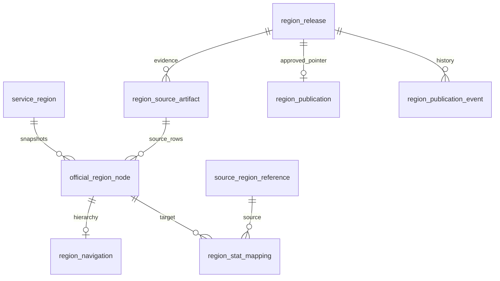

# H10 기준정보 DB — T06

현재 전국 원천 구현은 [T06 V4 문서](nationwide-reference-schema.md)를 우선한다. 아래는 V3 단계의 설계·189건 검증 이력이다. V4에서 원천 코드/부모 제약을 확장하며, T11은 별도 전국 통계 구조를 추가하는 최신 설계를 따른다.

기준일: 2026-11-08 · 브랜치: `feature/h10-reference-schema` · 기준 커밋: develop `9e18cca`

전국 공식 지역 식별자 H10과 서울 원천8 코드를 분리하는 저장 구조다. [V3 마이그레이션](../../src/main/resources/db/migration/V3__create_h10_reference_tables.sql)이 실행 기준이다. 실제 원본 적재·승인·게시 로직은 T07, 통계 6종의 H10 FK 전환은 T11에서 구현한다.

## 이번 변경

| 구분 | 내용 |
|---|---|
| 추가 | H10 업무 마스터·공식 스냅샷·계층·원천 대응·게시 이력 9개 테이블 |
| 기존 구조 | V1·V2, 업종 테이블, 기존 데이터·서울 목록 API 유지 |
| 초기 데이터 | V3는 테이블만 생성. seed·자동 게시·8→10 임의 변환 없음 |
| 공개 버전 | 공개 `regionVersion`·버전 불일치409는 추가하지 않음 |
| 데이터 적용 | 테스트 전용 MySQL에 적용. 개발 `pickplace` DB에는 적용하지 않음 |

기존 서울 경로를 영구 유지하려는 구조가 아니다. T11·T07·새 목록 API와 FE 전환이 준비된 뒤 기존 원천8 업무 경로를 제거한다. V3만 적용한 단계에서 H10 전환 전체가 끝났다고 표시하지 않는다.

## 테이블과 연결

| 테이블 | PK | 저장 책임 |
|---|---|---|
| `service_region` | H10 | 현재·과거를 포함한 안정적인 지역 식별자 |
| `region_release` | release_id | 내부 버전·처리 상태·승인자·검증 보고서 |
| `region_source_artifact` | release_id + artifact_role | 원본 ZIP/레이아웃의 해시·위치·수집 시점·이용 조건 검토 |
| `official_region_node` | release_id + H10 | 릴리스별 원본 이름·현행/과거·원문 및 검증 날짜 |
| `region_navigation` | release_id + H10 | 내부 부모와 화면 부모·표시명·선택 역할·검토 상태 |
| `source_region_reference` | 원천 체계 + 원천8 + 원천 영역 버전 | 원천명·부모5자리·기존 대조 근거·수집 출처 |
| `region_stat_mapping` | release_id + 원천 체계 + 원천8 + 원천 영역 버전 + H10 | 버전별 원천→H10 대응 후보와 검토 근거 |
| `region_publication` | NATIONWIDE_SELECTION | 현재 승인 릴리스·게시 revision |
| `region_publication_event` | event_id | 게시·이전 승인 릴리스로의 복구 이력 |



업무 식별자와 버전별 노드를 분리하면 현행 목록이 바뀌어도 과거 통계의 H10·대응 근거를 보존할 수 있다. 내부 계층과 화면 계층은 수원시→장안구와 경기도→수원시 장안구처럼 다를 수 있어 별도 컬럼으로 둔다. 원본 파일·게시 이력은 반복 JSON에 섞지 않고 독립 참조한다. 이 역할 분리로 기존 9테이블안을 채택했으며 추가 캐시·트리 경로 테이블·DB 트리거는 도입하지 않았다.

## DB가 검사하는 범위

| 규칙 | 보장 방식 |
|---|---|
| 업무 H10 | 정확한 ASCII 숫자10자리·PK |
| 원천 코드 | 서울 원천8·부모5·원천 영역 버전을 별도 키로 저장 |
| 릴리스 | 버전 유일성·상태 enum·처리 시각·승인 메타데이터·실패 사유 CHECK |
| 원본 참조 | 같은 릴리스의 artifact FK·원문 행번호 유일성·SHA256·양수 바이트 |
| 공식 날짜 | VALID의 생성일·말소일 일관성. INVALID는 검증 DATE 둘 다 null·사유 필수 |
| 계층 | 같은 릴리스 부모/시·도 FK·자기 부모 금지·미검토 선택 금지·역할 enum |
| 원천 대응 | 버전 포함 원천 FK·공식 노드 FK·VERIFIED 근거 필수 |
| 게시 | APPROVED 상태와 복합 FK. 미승인 릴리스 게시 및 게시 중 상태 해제 차단 |
| 게시 이력 | revision 연속성·revision 유일성·행위·주체·사유·릴리스 FK |

공식 이력 `4311073000`의 생성19900401/말소19900331은 원문을 보존하고 INVALID·사유와 함께 저장할 수 있다. 정상 DATE로 표시하거나 현재 선택·통계 대응에 사용하는 것은 허용하지 않는다. 저장 가능성과 공개 가능성을 구분한다.

## T07·T11·후속 API에서 보완할 범위

- FK는 행 존재만 확인한다. 부모 역할·소속·순환·공식 상태·날짜 품질과 실제 파일 행/해시 일치는 importer의 전수검사에서 확인한다.
- APPROVED의 메타데이터 CHECK는 전체 파일·계층·대응이 올바르다는 증거가 아니다. 필요한 원본 3종·건수·이용 조건·품질 보고서를 검증한 뒤 승인한다.
- 승인 후 노드·계층·대응의 불변성과 상태 전이는 T07 쓰기 경로에서 제어한다. 원시 SQL 수정까지 막는 DB 트리거는 이번 범위에 없다.
- 원천의 복수 대응 후보를 저장할 수 있다. 실제 채택 시 VERIFIED·유효 날짜·승인 릴리스·정확히 하나의 대응을 검사하고 H10 충돌·분할·합산을 임의 처리하지 않는다.
- 게시 포인터와 event 기록은 T07에서 같은 트랜잭션으로 처리한다. `FOR UPDATE` 또는 revision 조건 갱신으로 동시 게시 충돌을 막고, 실패 시 전체 롤백한다. 이번 테스트의 event INSERT는 publisher 구현·동시성 검증이 아니다.
- 현재 목록은 내부 release_id를 한 번 고정해 조회한다. 공개 선택 버전·FE 요청 간 스냅샷 고정은 도입하지 않는다.
- T11은 기존 통계6종의 원천8 FK를 H10 업무 FK와 대응 근거 FK로 전환한다. V3는 기존 FK를 변경하지 않는다.
- T07은 서울425대응·LEGACY3·업종100/지원3을 검증·적재한다. 현재/과거 탐색·상세 API·모델 지원은 별도 계약이다.

## 실행·검증

2026-11-08 전체 테스트 **189건 통과**, 실패·오류·건너뜀0건. 신규 H10 스키마 검사는20건이다. [테스트 집계](h10-reference-validation.json)를 함께 보관했다. 검증은 이 브랜치의 코드와 격리 MySQL에 한하며 통계 H10 전환·실제 원본 게시·FE/AI 연동·동시 게시 검수를 포함하지 않는다. 다운로드 작업 폴더에 남아 있는 미커밋 테스트는 이번 브랜치로 가져오지 않았다.

JDK25·실행 중인 Docker 환경에서 저장소 루트 기준:

```cmd
gradlew.bat test
```

테스트는 Testcontainers의 임시 MySQL8.4.11을 사용한다. 개발 Compose DB에 접속하거나 스키마를 초기화하지 않는다. 검증 항목은 [스키마 테스트](../../src/test/java/com/pickplace/backend/H10ReferenceSchemaTests.java)와 [업그레이드 테스트](../../src/test/java/com/pickplace/backend/StatisticsSchemaUpgradeTests.java)에 있다.

- 빈 DB의 V1→V2→V3 생성과 Flyway 검증·재실행0개.
- V1·V2 체크섬·기존 업종 지원 설정·원천8 지역·통계0·raw_payload 보존.
- 코드·원본·날짜·동일 릴리스 FK·원천 버전·복수 후보·승인·게시 revision 거절 사례.
- 기존 API·적재·다운로드 자동 테스트 회귀 검사.

이미 적용한 V1/V2는 변경하지 않는다. 로컬 서버를 새 브랜치로 실행하면 연결된 DB에 V3가 자동 적용될 수 있다. 이번 작업에서는 해당 서버를 실행하지 않았다. MySQL 여러 DDL의 전체 롤백을 가정하지 않으며, 중간 실패 시 서버를 중지하고 `flyway_schema_history`·실제 테이블을 확인한다. 데이터가 있는 환경에서는 사전 백업·복구 계획을 세우고, 원인 확인 없이 clean·repair·테이블 삭제를 수행하지 않는다.

관련: [데이터 정의서 v0.5](https://app.notion.com/p/3fa2114f823a818c9bd8e2664cbcd618) · [H10 설계안](https://app.notion.com/p/4122114f823a81bfab6ec11d5f0d77c2) · [V1 설계 이력](reference-schema-design.md) · [V2 통계 설계](statistics-schema-design.md).
