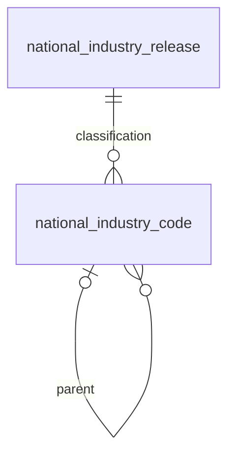

# 전국 원천 기준정보 DB — T06

구현일: 2026-11-09 · 브랜치: `feature/h10-reference-schema`

T07 후속: 구현은 `feature/nationwide-reference-import`로 이어졌고, 개발 DB에 V1~V4 적용 및 검토용 READY 기준정보 적재를 수행했다. [T07 실행 기록](../data/national-reference-import.md)을 현재 적용 상태로 참조한다. 아래 개발 DB 미적용/206건 문구는 T06 단독 검증 당시 이력이다.

전국 주민등록 인구와 소진공 상가 데이터의 지역·업종 식별자를 저장하는 스키마다. 기존 [V3 H10 구조](h10-reference-schema.md)에 [V4 마이그레이션](../../src/main/resources/db/migration/V4__extend_nationwide_reference_tables.sql)을 순서대로 적용한다. V1·V2·V3 SQL과 기존 서울 테이블은 변경하지 않았다.

## 구현 범위

| 대상 | 변경 |
|---|---|
| 원천 지역 | `MOIS_RESIDENT` H10, `SEMAS_STORE` 8자리, 기존 `SEOUL_COMMERCIAL` 8자리 허용 |
| 부모 코드 | 인구는 원천에 없으면 NULL, 제공한다면 H10. 상가·서울은 원천 5자리 필수 |
| 부모 명칭 | 인구·상가는 NULL/공란 원문 보존 가능. 기존 서울 필수 명칭 유지 |
| 지역 대응 | 원천 코드 길이를 10자리로 확장하고 체계·코드·버전 복합 FK 재연결 |
| 업종 분류본 | `national_industry_release`: 분류 버전·출처·해시·기준일·검증/승인 기록 |
| 업종 계층 | `national_industry_code`: 분류본별 대·중·소 코드·명칭·부모·화면 설정 |

코드의 길이가 맞거나 FK가 존재한다고 공식 대응이 승인되는 것은 아니다. 실제 H10 대조·구지면/고덕동 경계 판단·전국 원본 적재는 T07 이후의 작업이다. 초기 지원 후보 3업종을 자동으로 등록하거나 활성화하지 않는다.

## 업종 계층과 지원 여부

PK는 `(classification_id, industry_code)`다. 원천 명칭과 화면 명칭을 따로 저장하고 지원 여부는 기본 FALSE다. 같은 코드도 다른 분류본에 보존할 수 있다. 서울 `business_type`과 자동 연결하지 않는다.

부모는 `(classification_id, parent_code, parent_level)` FK와 단계 CHECK로 검증한다. 대분류는 부모 없음, 중분류의 부모는 대분류, 소분류의 부모는 중분류다. 다른 분류본 부모·단계 건너뛰기·자기 부모·계층 순환을 허용하지 않는다. 원천의 실제 부모 관계와 명칭 충돌은 적재기가 별도로 검사한다.

`is_supported=TRUE`는 소분류에만 허용하며 `support_release_status='APPROVED'`를 함께 지정해야 한다. 이 값은 분류본의 승인 상태를 참조하는 FK다. 미승인 분류본에서 지원을 켤 수 없고, 지원 중인 분류본의 승인을 해제할 수 없다. 비지원 행의 해당 참조는 NULL이다. 승인 자체에는 보고서·승인자·승인 시각이 필요하다.

DB는 입력된 승인 메타데이터를 검사한다. 실제 원본 전수 검사와 승인 후 분류 내용 불변성·지원 정책 변경 절차는 T07 쓰기 경로에서 보장해야 한다.

## 이행과 검증

개발 DB를 읽기 전용 확인했으며 테이블은 없었다. 개발 DB에는 마이그레이션을 적용하지 않았다. 테스트는 Testcontainers의 격리 MySQL 8.4.11을 사용한다.

| 검사 | 대상 |
|---|---|
| 빈 DB 생성 | V1→V2→V3→V4, 재실행·Flyway 체크섬 검증 |
| 기존 DB 업그레이드 | V3의 원천 코드·명칭·증거 보존, V1/V2 통계 0·지원 설정 보존 |
| 원천 계약 | 인구 H10/부모 NULL·세종 공란, 원천별 잘못된 코드·길이·부모 거부 |
| 대응 FK | 10자리 identity mapping, 잘못된 namespace·버전·릴리스·대상 및 참조 삭제 거부 |
| 업종 | 분류 버전 분리·부모/단계/순환·미승인 활성화·비소분류 활성화 거부 |

[전국 기준정보 테스트](../../src/test/java/com/pickplace/backend/NationwideReferenceSchemaTests.java) · [업그레이드 테스트](../../src/test/java/com/pickplace/backend/StatisticsSchemaUpgradeTests.java)

테스트 수와 최종 실행 결과는 [검증 기록](nationwide-reference-validation.json)을 참조한다. 기존 189건 통과는 V3 단계의 이력이며 V4 검증과 구분한다.

전체 `clean check bootJar`는 21개 스위트·206건 통과(실패/오류/건너뜀0). 이후 기존 VERIFIED 대응표를 업그레이드 검사의 입력에 추가하고 해당1건을 다시 실행해 통과했다. 전체 실행 이후 SQL·실행 코드는 바꾸지 않았다. 마지막 선택 실행은 Gradle 생성 보고서를 해당 스위트로 교체하므로 두 실행을 검증 기록에서 구분한다.

## 다음 단계

- T07: 공식 지역·원천 대응·소진공 분류를 검증하고 기준정보 적재·승인·게시 구현.
- T11: 별도 전국 인구·업소 통계/적재 스키마 구현. 기존 서울 통계 의미와 혼합하지 않음.
- 후속 API: 월 기준과 전국 업종 코드 계약 개정 후 목록·현황 조회 연결.

현재 명령형 적재기와 조회 API는 기존 서울 경로다. 이번 스키마 추가만으로 전국 데이터 조회가 제공되지는 않는다. 서버 시작 시 Flyway가 연결된 DB에 V3/V4를 적용할 수 있으므로 실제 적용 전 대상·이력·복구 절차를 확인한다. MySQL DDL 전체가 일반 트랜잭션으로 롤백된다고 가정하지 않는다.
