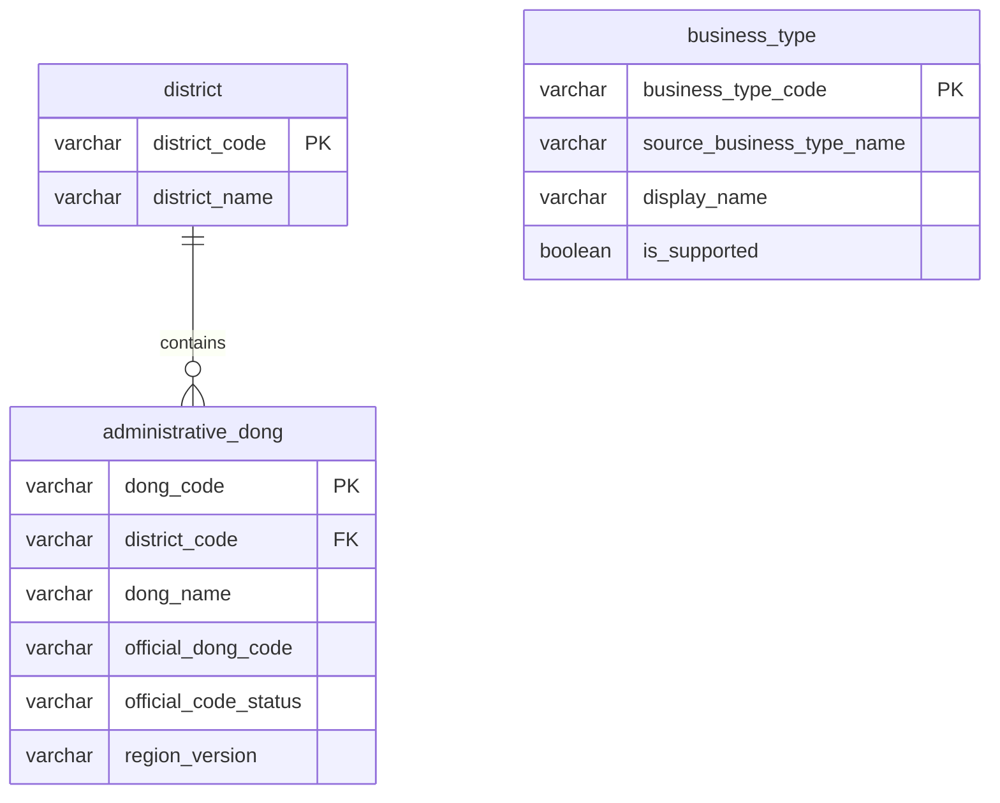

# 기준정보 DB 설계

> 검증 기준: 2026-10-26 · MySQL 8.4.11 · Spring Data JPA  
> 테이블 생성과 수동 적재를 임시 MySQL에서 검증했다. 개발 DB에는 적용하지 않았다.

[문서 목록](../README.md) · [마이그레이션 검증](migration-validation.md) · [수동 적재 방법](../data/reference-import.md)

## 1. 설계 범위

지역·업종 선택 화면에 필요한 기준정보를 3개 테이블로 관리한다.

| 테이블 | 역할 | 초기 스냅샷 |
|---|---|---|
| `district` | 자치구 코드·명칭 | 25개 |
| `administrative_dong` | 행정동·소속 자치구·공식 코드 대응 | 425개 |
| `business_type` | 원천 업종·화면 표시명·지원 여부 | 100개, 초기 지원 3개 |

행정동 425개는 **통계 원천의 지역 목록**이다. 2026-10-12 공식 코드표의 현행 427개 동과 다르며, 현재 경계 전체를 제공한다는 뜻이 아니다.

| 구분 | 현재 구현 | 후속 작업 |
|---|---|---|
| 스키마 | Flyway V1·PK/FK/CHECK | 변경 시 V2 이상 추가 |
| 초기 적재 | 고정 스냅샷·수동 명령·재적재 검증 | 개발 DB 실제 반영 |
| 조회 | 아직 구현하지 않음 | Entity·Repository·목록 API |
| 통계·지도 | 이번 범위 아님 | 인구·점포·매출·시설 통계, 좌표·경계 |

설계 근거: [데이터 정의서](https://app.notion.com/p/3fa2114f823a818c9bd8e2664cbcd618) · [T06 테이블 생성](https://app.notion.com/p/3f42114f823a813d83c9ce5714ddf36a) · [T07 초기 적재](https://app.notion.com/p/3f42114f823a8144b85ae2859153c767)

## 2. 테이블 관계

- 한 자치구에 여러 행정동이 속하며, FK로 부모 자치구의 존재를 보장한다.
- 업종은 지역의 자식이 아니다. 행정동마다 업종 기준정보를 복제하지 않는다.
- 지역·업종 조합은 후속 점포·매출 통계 테이블에서 연결한다.
- 자치구마다 최소 한 동이 존재하는지는 FK가 아닌 적재 검증에서 확인한다.

## 3. 테이블 명세

### 3.1 자치구 — `district`

| 컬럼 | 타입 | 제약 | 설명 |
|---|---|---|---|
| `district_code` | `VARCHAR(5)` | PK, NOT NULL | 원천 `SIGNGU_CD`, 숫자 5자리 |
| `district_name` | `VARCHAR(100)` | NOT NULL | 원천 `SIGNGU_NM` |
| `data_version` | `VARCHAR(100)` | NOT NULL | 원본·해시를 식별하는 스냅샷 버전 |
| `collected_at` | `DATETIME(6)` | NOT NULL | 실제 원천 수집 완료 시각, UTC |
| `created_at` | `DATETIME(6)` | NOT NULL | DB 최초 저장 시각, UTC |
| `updated_at` | `DATETIME(6)` | NOT NULL | DB 행의 실제 변경 시각, UTC |

이름에 UNIQUE를 걸지 않는다. 이름은 표시용이며 연결에는 코드를 사용한다.

### 3.2 행정동 — `administrative_dong`

| 컬럼 | 타입 | 제약 | 설명 |
|---|---|---|---|
| `dong_code` | `VARCHAR(8)` | PK, NOT NULL | 원천 `ADSTRD_CD`, 숫자 8자리 |
| `dong_name` | `VARCHAR(100)` | NOT NULL | 원천 `ADSTRD_NM` / `ADSTRD_CD_NM` |
| `district_code` | `VARCHAR(5)` | FK, NOT NULL | `district.district_code` 참조 |
| `region_version` | `VARCHAR(100)` | NOT NULL | 지역 원본·코드 대조 자료의 스냅샷 버전 |
| `official_dong_code` | `VARCHAR(10)` | NULL 허용 | 행안부 현재·말소 코드 |
| `official_dong_name` | `VARCHAR(100)` | NULL 허용 | 행안부 코드표의 공식 명칭 |
| `official_code_status` | `VARCHAR(20)` | NOT NULL, CHECK | `CURRENT` / `LEGACY` / `UNVERIFIED` |
| `official_created_on` | `DATE` | NULL 허용 | 공식 코드 생성일 |
| `official_abolished_on` | `DATE` | NULL 허용 | 공식 코드 말소일 |
| `reference_snapshot_on` | `DATE` | NULL 허용 | 대조한 공식 코드표 기준일 |
| `collected_at` | `DATETIME(6)` | NOT NULL | 원천 영역 수집 완료 시각, UTC |
| `created_at` | `DATETIME(6)` | NOT NULL | DB 최초 저장 시각, UTC |
| `updated_at` | `DATETIME(6)` | NOT NULL | DB 행의 실제 변경 시각, UTC |

원천 코드·명칭을 공식 코드·명칭으로 덮어쓰지 않는다. 부모 관계는 검증된 대응표를 사용하며 코드 앞자리만으로 영구 가정하지 않는다.

#### 공식 코드 상태별 조건

| 상태 | 의미 | 필수 조건 |
|---|---|---|
| `CURRENT` | 대조한 공식 코드표에서 현재 코드 | 공식 코드·명칭·기준일 필수, 말소일 없음 |
| `LEGACY` | 공식 말소 이력에 존재 | 공식 코드·명칭·기준일·말소일 필수 |
| `UNVERIFIED` | 공식 대응을 아직 확인하지 못함 | 공식 코드·명칭·날짜·기준일 모두 NULL |

- 생성일은 확인 가능한 경우 저장한다. 생성일과 말소일이 모두 있으면 생성일 ≤ 말소일이어야 한다.
- DB는 `UNVERIFIED`를 표현할 수 있지만, 현재 초기 적재기는 검증된 `CURRENT`·`LEGACY`만 허용한다.
- 고정 스냅샷의 공식 상태는 CURRENT 422개, LEGACY 3개다.
- CURRENT 여부와 실제 통계 경계의 현행 일치는 별개다. `region_version`도 실제 경계 버전의 확인을 보증하지 않는다.
- 공식 코드에는 UNIQUE를 두지 않는다. 복수 원천 코드의 대응 가능성은 별도 검수한다.

### 3.3 업종 — `business_type`

| 컬럼 | 타입 | 제약·기본값 | 설명 |
|---|---|---|---|
| `business_type_code` | `VARCHAR(20)` | PK, NOT NULL | 원천 `SVC_INDUTY_CD`, CS + 숫자 6자리 |
| `source_business_type_name` | `VARCHAR(100)` | NOT NULL | 원천 `SVC_INDUTY_CD_NM` |
| `display_name` | `VARCHAR(100)` | NOT NULL | 화면 표시명 |
| `is_supported` | `BOOLEAN` | NOT NULL, FALSE | 화면 선택 지원 여부 |
| `display_order` | `INT` | NOT NULL, 0 | 표시 순서, 0 이상 |
| `data_version` | `VARCHAR(100)` | NOT NULL | 업종 목록 근거 스냅샷 버전 |
| `collected_at` | `DATETIME(6)` | NOT NULL | 근거 원본 수집 완료 시각, UTC |
| `created_at` | `DATETIME(6)` | NOT NULL | DB 최초 저장 시각, UTC |
| `updated_at` | `DATETIME(6)` | NOT NULL | DB 행의 실제 변경 시각, UTC |

서비스 업종 코드는 KSIC 코드와 별개다. 전체 업종 저장과 화면 지원 여부도 구분한다.

| 코드 | 원천명 | 초기 표시명 | 초기 지원 |
|---|---|---|---|
| `CS100010` | 커피-음료 | 커피·음료 | TRUE |
| `CS100008` | 분식전문점 | 분식 | TRUE |
| `CS100005` | 제과점 | 제과점 | TRUE |

다른 업종은 원천명을 초기 표시명으로 사용하고 지원 여부를 FALSE로 둔다. 재적재 시 기존 표시명·지원 여부·정렬순서를 유지한다.

## 4. 키·인덱스·조회

### 키와 코드

- 코드를 문자열 PK로 직접 사용한다. 별도 숫자 ID·자동 증가 ID는 추가하지 않는다.
- 코드 비교는 `ascii_bin`, 한글 명칭은 `utf8mb4`를 사용한다.
- 코드 컬럼은 `VARCHAR`와 형식 CHECK를 사용해 잘못된 길이·문자·후행 공백을 거부한다.
- 원천 코드체계가 바뀌면 자동 보정하지 않고 격리·검토 후 명세와 스키마를 변경한다.
- 공식 코드를 원천 코드에 단순히 0을 붙여 생성하지 않는다.

### 인덱스와 API 연결

| 테이블 | 인덱스·조회 방식 | 연결 API |
|---|---|---|
| `district` | PK 코드 조회, 이름 인덱스 추가 없음 | A2 자치구 목록 |
| `administrative_dong` | `(district_code, dong_name, dong_code)` | A3 자치구별 행정동 목록 |
| `business_type` | 지원 여부 필터 후 `display_order, business_type_code` 정렬 | A4 지원 업종 목록 |

자치구 25개·업종 약 100개 규모에서는 별도 이름·지원 여부 인덱스를 추가하지 않는다. 행정동의 복합 인덱스가 FK 컬럼으로 시작하므로 단독 FK 인덱스도 중복 생성하지 않는다.

DB의 `snake_case`와 API 응답 필드명은 DTO에서 분리한다.

## 5. 변경·삭제·이력 정책

### 삭제와 부모 관계

- FK에 CASCADE를 사용하지 않는다. 자식이 있는 자치구의 삭제·PK 변경은 거부한다.
- 코드 말소는 행 삭제 사유가 아니다. 말소된 동과 과거 통계를 보존한다.
- 키·부모 관계는 임의 수정하지 않는다. 정정이 필요하면 원천과 영향 범위를 먼저 검토한다.

### 버전과 이력

현재 테이블은 **초기 고정 기준정보 스냅샷**이다. 모든 과거 명칭·부모·경계 변경을 보관하는 이력 DB는 아니다.

원본과 코드 대응표는 해시·버전 manifest로 보존한다. 새 버전에서 같은 코드의 부모·의미·경계가 달라지면 자동 병합하지 않는다. 별도 지역 이력·버전 테이블과 통계의 복합 참조를 설계한 뒤 이관한다.

통계가 `dong_code`만 참조하는 구조로는 지역의 모든 과거 변경을 표현할 수 없다.

### 현재 적재기의 동작

| 상황 | 처리 |
|---|---|
| 신규 코드 | 부모·필수값 검사 후 INSERT |
| 같은 원본 재실행 | INSERT/UPDATE 없이 기존 값·시각 유지 |
| 기존 업종의 서비스 설정 변경 | 표시명·지원 여부·정렬순서 보존 |
| 원천명·부모·공식 대응·버전 충돌 | 덮어쓰기 없이 전체 중단·이번 INSERT 롤백 |
| 신규 원천 정정본·분동·통합 | 현재 적재기에서 자동 처리하지 않음 |

수집 시각은 실제 원천 metadata의 `downloadedAt` / `fetchedAt`을 사용한다. 공식 코드표 기준일·수집 시각·DB 저장 시각을 구분한다.

## 6. JPA 구현 원칙 — 아직 미구현

- ID는 `String`으로 직접 할당하고 `@GeneratedValue`를 사용하지 않는다.
- 행정동 → 자치구 단방향 LAZY 관계를 제안한다.
- 목록은 DTO 조회 등으로 N+1을 방지하고 Entity를 API 응답으로 직접 노출하지 않는다.
- 직접 할당 ID의 신규 판정과 `save` / `merge` 동작은 Entity 구현 때 검토한다.
- 현재 기준정보 배치 적재에는 JDBC를 사용한다. 향후 조회 API의 JPA 선택을 변경한 것은 아니다.

## 7. 실제 DDL과 검증 기록

SQL 본문은 문서에 중복 복사하지 않고 실행 파일을 기준으로 확인한다.

| 자료 | 용도 |
|---|---|
| [V1 마이그레이션](../../src/main/resources/db/migration/V1__create_reference_tables.sql) | 실제 테이블 생성 기준 |
| [이전 검토용 SQL](reference-schema-draft.sql) | 최초 설계 이력, 별도 실행 금지 |
| [마이그레이션 검증](migration-validation.md) | V1·제약조건 검증 결과 |
| [수동 적재 문서](../data/reference-import.md) | 실행 방법·원천·재적재 검증 |
| [원천 manifest](../data/reference-source-manifest.json) | 원본 URL·조회 조건·해시·수집 시각 |

이미 적용한 V1을 수정하지 않고 V2 이상의 새 마이그레이션을 추가한다. `IF NOT EXISTS`로 기존 스키마 불일치를 숨기지 않는다.

CHECK는 NULL에서 UNKNOWN으로 통과할 수 있으므로 필수 조건에 `IS NOT NULL`을 명시했다. FK는 기본 참조 동작으로 부모 변경·삭제를 제한한다.

참고: [MySQL 8.4 CHECK](https://dev.mysql.com/doc/refman/8.4/en/create-table-check-constraints.html) · [외래 키](https://dev.mysql.com/doc/refman/8.4/en/create-table-foreign-keys.html)

## 8. 검증 완료와 남은 작업

### 검증 완료 — 임시 MySQL

- [x] 빈 DB의 V1 적용·이력 생성·재실행·체크섬 유효성
- [x] 세 테이블 PK 중복 및 부모 FK 위반 거부
- [x] 코드 형식·공백 이름·공식 상태·날짜·지원값 CHECK
- [x] 자치구 25개·행정동 425개·업종 100개 적재
- [x] 전체 행정동의 부모·공식 코드·명칭 대응
- [x] 재적재 시 전체 값·시각·서비스 설정 유지, 충돌 시 롤백

최신 전체 빌드는 **34건 성공**이다. 최초 V1 단계의 23건과 T07 후속 검증 11건을 구분해 각 검증 문서에 기록했다.

### 남은 작업

- [ ] 개발 DB 실제 적재 및 팀 검토
- [ ] Entity·Repository·목록 API 구현과 응답 검수
- [ ] FE와 원천/현재 지역 선택·LEGACY 안내 정책 확정
- [ ] 지도 좌표·면적·경계 및 통계 테이블 설계·검수

시설 응답의 `attractingFacilityCount` / `totalFacilityCount` 명칭 차이는 T02에서 통일한다. 이번 기준정보 테이블에는 해당 시설 컬럼을 추가하지 않는다.

