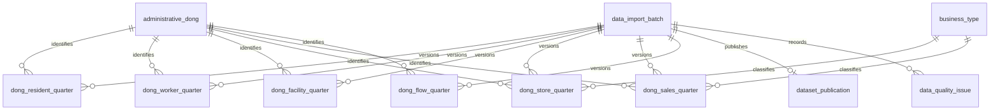

# 상권 통계·적재 이력 DB 설계

> T11 · 스키마 구현
>
> 기준: [데이터 정의서](https://app.notion.com/p/3fa2114f823a818c9bd8e2664cbcd618) · [T11 작업](https://app.notion.com/p/3f42114f823a816e992dc145b433f264)
>
> 실행 기준: [Flyway V2](../../src/main/resources/db/migration/V2__create_statistics_tables.sql)

## 한눈에 보기

| 구분 | 이번 변경 |
|---|---|
| 생성 | 통계 6개 + 적재 배치·게시 포인터·품질 이슈 3개 테이블 |
| 기준정보 | V1의 자치구·행정동·업종을 재사용. V1 SQL과 기존 데이터는 변경하지 않음 |
| 저장 단위 | 인구·시설: 행정동×분기 / 점포·매출: 행정동×업종×분기 |
| 버전 관리 | 같은 분기를 다시 수집해도 배치별 보존. 게시 포인터로 조회할 버전 선택 |
| 초기 공개 대상 | 상주인구·직장인구·점포·집객시설 4종 |
| 공개 보류 | 매출·길단위인구는 원본 보존용. 집계 의미 확인 전 게시 차단 |
| 다음 작업 | T14에서 실제 통계 적재·검사·게시 전환 구현. 현황·추이 API는 별도 작업 |
| 적용 범위 | 격리 MySQL 테스트. 개발 DB에 대한 실제 적용·통계 데이터 적재는 별도 확인 |

## 테이블 목록과 유일성

분기는 `YYYYQ` 문자열이다. 예: `20262`는 2026년 2분기. 배치 하나는 데이터셋 하나·분기 하나를 처리한다.

| 테이블 | 데이터셋 | 한 배치 안의 PK | 주요 값·단위 |
|---|---|---|---|
| `dong_resident_quarter` | RESIDENT · OA-22183 | batch_id + dong_code | resident_population · 명 |
| `dong_worker_quarter` | WORKER · OA-22184 | batch_id + dong_code | worker_population · 명 |
| `dong_facility_quarter` | FACILITY · OA-22169 | batch_id + dong_code | total_facility_count · 개 |
| `dong_store_quarter` | STORE · OA-22172 | batch_id + dong_code + business_type_code | total_store_count · 개 |
| `dong_sales_quarter` | SALES · OA-22175 | batch_id + dong_code + business_type_code | source_sales_amount · 원, source_sales_count · 건 |
| `dong_flow_quarter` | FLOW · OA-22178 | batch_id + dong_code | source_flow_population · 원천 인구값 |
| `data_import_batch` | 모든 데이터셋 | batch_id | 수집·검사·실행 버전과 처리 결과 |
| `dataset_publication` | 핵심 4종만 | dataset_code + quarter_code | 공개할 성공 배치 하나 |
| `data_quality_issue` | 모든 데이터셋 | issue_id | 원천 행·필드별 품질 문제 |

**인구·시설에는 업종 컬럼이 없다.** 업종별 점포와 결합한 뒤 인구·시설을 다시 합산하지 않는다. 지원 업종 3개는 서비스 선택 범위이며 통계 FK는 기준정보의 전체 업종을 허용한다.

`batch_id`가 분기와 데이터셋을 고정하므로 통계 PK는 해당 배치 안에서 동·업종 중복을 막는다. 다른 배치에 같은 분기·동·업종이 존재하는 것은 재적재 이력이다. 공개 포인터는 데이터셋·분기별 하나만 허용해 응답에서 이력이 중복 집계되지 않도록 한다.

## 관계



## 저장·조회 흐름

1. 데이터셋·분기마다 `RUNNING` 배치를 만든다.
2. 해당 배치 ID로 통계와 품질 이슈를 저장한다. 기존 공개 배치는 수정하지 않는다.
3. T14 적재기가 범위·중복·결측·행 수·검사 결과를 확인한다.
4. 검사에 통과하면 배치를 `SUCCEEDED`로 확정한다.
5. 별도 트랜잭션에서 `dataset_publication`의 배치 ID를 교체한다.
6. 조회는 반드시 게시 포인터와 통계를 JOIN한다.

중간 실패 시 새 배치를 `FAILED`로 기록하고 게시 포인터를 유지한다. 성공 판정·전환의 동시 실행 제어·실패 복구 코드는 T14에서 구현한다. 배치를 완료한 뒤에는 그 통계 행과 검사 결과를 변경하지 않는 정책이다. 이 불변성은 애플리케이션이 지켜야 하며 현재 DDL에 트리거나 별도 쓰기 권한을 추가하지 않았다.

### 공개된 상주인구 조회 예시

```sql
SELECT s.dong_code, s.quarter_code, s.resident_population,
       s.row_status, s.reason_code, b.data_version, b.collected_at, p.published_at
FROM dataset_publication p
JOIN data_import_batch b ON b.batch_id = p.batch_id
JOIN dong_resident_quarter s
  ON s.batch_id = p.batch_id
 AND s.dataset_code = p.dataset_code
 AND s.quarter_code = p.quarter_code
WHERE p.dataset_code = 'RESIDENT'
  AND p.quarter_code = '20262'
  AND s.dong_code = '11110515';
```

`MAX(batch_id)`나 `MAX(quarter_code)`만으로 최신 자료를 선택하지 않는다. 수집 중·실패·미게시 배치가 포함될 수 있다. 기본 조회 분기는 후속 API에서 핵심 4종 모두 공개된 공통 분기로 선택한다. `latestPublishedQuarter` 같은 원천 제공 정보는 게시 포인터만으로 추정하지 않는다.

## 값과 누락 상태

통계 테이블의 `row_status`는 **주요 값 한 개의 정제 상태**다. 배치의 검사 통과나 공개 가능 여부를 뜻하지 않는다.

| row_status | 주요 값 | reason_code | 의미 |
|---|---|---|---|
| AVAILABLE | 0 이상의 숫자 | NULL | 원천 값 사용 가능. 실제 0도 그대로 저장 |
| NO_DATA | NULL | SOURCE_VALUE_MISSING | 행은 있으나 주요 값이 없음 |
| INVALID | NULL | QUALITY_CHECK_FAILED | 주요 값 검사 실패. 원래 값은 raw_payload에 보존 |

- 없는 원천 행을 0이나 가짜 통계 행으로 만들지 않는다.
- `SOURCE_ROW_ABSENT`는 완전한 적재를 검증한 배치에서만 조회 시 판정한다.
- 코드 오류 등으로 행 전체가 제외되면 `data_quality_issue`를 확인해 단순 원천 부재와 구분한다.
- 미적재 상태 `NOT_LOADED / NOT_INGESTED`는 통계 행에 저장하지 않는다. 후속 조회 API가 적재·게시 이력을 함께 확인해 결정한다.
- 매출·길단위인구의 `AVAILABLE`은 원천 숫자가 유효하다는 뜻일 뿐이다. `aggregation_status=UNVERIFIED`와 게시 제한이 별도로 적용된다.

<details>
<summary><strong>공통 통계 컬럼·자료형</strong></summary>

| 컬럼 | 자료형·필수 | 역할 |
|---|---|---|
| batch_id | BIGINT · 필수 | 적재 배치 ID |
| dataset_code | VARCHAR(16) · 필수 | 테이블별 고정값. CHECK로 다른 종류 차단 |
| quarter_code | VARCHAR(5) · 필수 | 배치의 데이터셋·분기와 복합 FK로 일치 강제 |
| dong_code | VARCHAR(8) · 필수 | 서울 원천 행정동 코드. V1 행정동 FK |
| business_type_code | VARCHAR(20) · 점포·매출만 필수 | V1 업종 FK |
| region_version | VARCHAR(100) · 필수 | 이 행을 해석할 때 사용한 지역 매핑 버전 |
| 주요 값 | BIGINT 또는 DECIMAL(20,0) · NULL 허용 | 결측·오류를 0과 구분 |
| row_status / reason_code | VARCHAR(10) / VARCHAR(32) | 주요 값 상태와 원인 |
| raw_payload | JSON · 필수 | 원천 필드명·값 보존. 정제값과 분리 |
| aggregation_status | VARCHAR(16) · 매출·길단위인구만 필수 | UNVERIFIED 고정 |

초기 핵심 4종의 숫자는 `0..9007199254740991` 범위다. 프런트엔드 Number가 정확히 표현할 수 있는 정수 범위를 넘으면 원본을 보존하고 INVALID로 처리한다. 매출 금액은 DECIMAL(20,0), 길단위인구는 BIGINT에 원천 정수로 저장하며 초기 화면에 노출하지 않는다.

원천의 모든 성별·연령대·시간대·시설 세부 항목은 raw_payload에 보존한다. 현재 조회에 필요한 주요 값만 정규 컬럼으로 분리했으며, 실제 사용이 확정된 세부 지표는 후속 마이그레이션에서 추가한다.

</details>

<details>
<summary><strong>원천 필드 매핑·점포 세부 컬럼</strong></summary>

| 원천 | 원천 필드 | 정규 컬럼 |
|---|---|---|
| OA-22183 | TOT_REPOP_CO | resident_population |
| OA-22184 | TOT_WRC_POPLTN_CO | worker_population |
| OA-22169 | VIATR_FCLTY_CO | total_facility_count |
| OA-22172 | SIMILR_INDUTY_STOR_CO | total_store_count |
| OA-22172 | STOR_CO | general_store_count |
| OA-22172 | FRC_STOR_CO | franchise_store_count |
| OA-22172 | OPBIZ_STOR_CO | opened_store_count |
| OA-22172 | CLSBIZ_STOR_CO | closed_store_count |
| OA-22175 | THSMON_SELNG_AMT / THSMON_SELNG_CO | source_sales_amount / source_sales_count |
| OA-22178 | TOT_FLPOP_CO | source_flow_population |

점포의 세부 수는 NULL 또는 0 이상의 정수다. 전체·일반·프랜차이즈가 모두 있으면 `total = general + franchise`를 CHECK로 검사한다. 빠진 세부 수를 전체에서 역산하거나, 결측인 전체를 임의 합산하지 않는다.

집객시설 수는 정규 컬럼 total_facility_count 하나이며 세부 항목의 합으로 대체하지 않는다. 개·폐업 수를 폐업 확률로 해석하지 않는다. 매출 원천 금액 단위는 원이며 월평균·분기합을 확정하거나 3으로 나누지 않는다. 길단위인구도 고유 방문자 수·일평균으로 변환하지 않는다.

</details>

<details>
<summary><strong>적재 배치 이력·검사 결과</strong></summary>

| 컬럼 | 필수·허용값 | 의미 |
|---|---|---|
| batch_id | 자동 증가 PK | 실행 시도 식별자 |
| dataset_code / quarter_code | 필수 | 한 종류·한 분기 |
| source_id / source_url | 필수·공백 불가 | OA 식별자와 공개 원본 URL. 인증키를 저장하지 않음 |
| source_checksum | 필수·소문자 SHA-256 64자리 | 원본 파일 전체 바이트의 해시 |
| parser_version | 필수·공백 불가 | 정제 로직 버전 |
| data_version | 필수·공백 불가 | 결과 데이터 버전. 게시 포인터가 이 배치를 참조하면 공개 버전 |
| status | RUNNING / SUCCEEDED / FAILED | 처리 상태 |
| collected_at | 성공 시 필수 | 원본 확보 시각 |
| started_at / finished_at | 시작 필수·완료 시 필수 | 실행 시각. 모든 DATETIME은 UTC |
| source_row_count | 성공 시 필수 | 이 분기 대상으로 읽은 원천 행 수 |
| accepted_row_count | 성공 시 필수 | 중복 제외 후 통계 테이블에 저장한 고유 행 수. INVALID·NO_DATA 행도 포함 |
| rejected_row_count | 성공 시 필수 | 키 오류 등으로 통계 테이블에 넣지 못한 행 수 |
| duplicate_row_count | 성공 시 필수 | 중복으로 제외한 행 수 |
| validation_report | JSON · 성공 시 필수 | 검사별 결과·적용 기준·분기 범위·완전성·이슈 집계 |
| failure_code | FAILED만 필수 | 실패 분류. SQL·인증정보를 그대로 저장하지 않음 |

행 수 4개는 모두 NULL이거나 모두 0 이상이어야 하고 `source = accepted + rejected + duplicate`여야 한다. 원본 파일에 여러 분기가 있으면 배치의 행 수는 해당 분기만 센다.

SUCCEEDED에는 완료 시각·수집 시각·행 수·검사 결과가 필요하다. FAILED에는 완료 시각·실패 코드가 필요하다. 완료 시각은 시작보다 빠를 수 없다. 실패 전에 파일을 얻지 못했다면 수집 시각·행 수는 NULL일 수 있다.

동일 원본·파서 조합을 유일 키로 막지 않는다. 실패 후 재시도도 이력으로 남겨야 하기 때문이다. 재사용·재실행 멱등성 판단은 T14에서 구현한다.

</details>

<details>
<summary><strong>게시 포인터·품질 이슈·DB 제약의 경계</strong></summary>

**dataset_publication**

- `(dataset_code, quarter_code)`당 공개 배치 하나.
- `batch_status=SUCCEEDED` 고정값과 복합 FK로 RUNNING·FAILED 배치 참조를 차단.
- 매출·길단위인구는 데이터셋 CHECK로 게시 차단. 의미 검증 후 별도 마이그레이션으로 해제.
- published_at은 서비스에서 버전을 공개한 시각이며 원천 데이터의 공개 시각과 다르다.
- 공개 중인 배치는 FK 때문에 삭제하거나 FAILED로 바꿀 수 없다. 회수가 필요하면 먼저 게시 포인터를 조정한다.

**data_quality_issue**

`batch_id, source_row_number, raw_dong_code, raw_business_type_code, field_name, issue_code, severity, raw_value`를 기록한다. 한 원천 행에 여러 문제를 기록할 수 있다. 원본 파일 기준 행 번호를 쓰고 헤더 포함 여부는 파서 규칙에 명시한다.

원천 코드는 오류를 기록하기 위한 값이므로 지역·업종 FK를 걸지 않는다. 배치 FK만 적용한다. 품질 이슈 수는 거부된 행 수와 같지 않으며 동일 행의 중복 이슈를 행 수에 더하지 않는다.

**DDL이 보장하지 않는 것**

실제 저장 행 수와 이력 카운터의 일치, 원천 전체 범위 수집, JSON 내부 검사 결과의 진실성, 불변 배치 정책, 게시 전환 시 동시 실행 순서는 T14의 트랜잭션·검사 코드가 보장해야 한다. SUCCEEDED 한 값만으로 완전한 데이터라고 판단하지 않는다. 현재 T11에는 수동 운영용 적재·게시 SQL이나 공개 관리 API를 추가하지 않는다.

정수 여부·자리수·자료형은 DB에 전달하기 전에 적재기가 검사한다. 소수나 문자열을 MySQL의 암묵적 형변환으로 정수 컬럼에 넣지 않는다.

</details>

<details>
<summary><strong>조회 인덱스</strong></summary>

| 테이블 | 인덱스 | 용도 |
|---|---|---|
| 인구·시설·길단위인구 | dong_code, quarter_code, batch_id | 동별 분기 조회·추이 |
| 점포·매출 | dong_code, business_type_code, quarter_code, batch_id | 선택 업종의 동별 분기 조회·추이 |
| 통계 전체 | PK의 batch_id 선두 | 게시 배치 단위 조회·검사 |
| data_import_batch | dataset_code, quarter_code, status | 종류·분기별 처리 이력 |
| data_import_batch | dataset_code, quarter_code, source_checksum, parser_version | 같은 입력 재시도 검색 |
| dataset_publication | PK(dataset_code, quarter_code) | 종류·분기별 공개 버전 |
| data_quality_issue | batch_id, raw_dong_code, raw_business_type_code | 누락·키 오류 원인 확인 |

실제 목록·추이 쿼리가 구현되면 EXPLAIN으로 확인한다. T11에서 아직 없는 API 쿼리의 실행 계획을 검증했다고 주장하지 않는다.

</details>

## 적용·검증 방법

### 개발 DB 적용

기존 local 프로필의 환경변수를 지정한 뒤 저장소 루트에서 실행한다.

```cmd
gradlew.bat bootRun --args="--spring.profiles.active=local"
```

Flyway가 미적용 V1·V2를 순서대로 적용한다. 이미 V1이 있으면 V2만 적용하며 기준정보는 그대로 둔다. **기동 대상 DB를 먼저 확인한다.** 기존 스키마와 Flyway 이력이 다르면 자동 우회하지 않고 원인을 확인한다. 서버 실행은 테이블 생성까지이며 통계 원본 적재는 하지 않는다.

```sql
SELECT version, description, success
FROM flyway_schema_history
ORDER BY installed_rank;

SELECT table_name
FROM information_schema.tables
WHERE table_schema = DATABASE()
ORDER BY table_name;
```

정상 결과는 V1·V2 성공 이력, 업무 테이블 12개(기준정보 3개 + 신규 9개), Flyway 이력 테이블 1개다. 기존 통계가 없다면 신규 테이블의 행 수는 0이다.

### 격리 테스트

Docker Desktop 실행 후:

```cmd
gradlew.bat test --tests "*StatisticsSchema*"
gradlew.bat clean build
```

| 테스트 | 검증 |
|---|---|
| StatisticsSchemaUpgradeTests | 실제 MySQL에서 V1 적용·기존 행 저장 후 V2 업그레이드, 기존 값 보존·재실행 무변경 |
| StatisticsSchemaMigrationTests | 6종 정상·0·NULL·오류, 유일성·FK·분기·정수 범위·점포 합계·이력·게시 제한·실패 후 기존 공개값 유지 |
| 기존 전체 테스트 | 기준정보 적재·조회·공통 응답·상태 API 회귀 확인 |

개발용 Compose DB 대신 Testcontainers의 임시 MySQL 8.4.11을 사용한다. 검증 후 임시 DB는 제거된다. 검증된 테스트 수·실행 결과는 PR 또는 작업 카드에 기록한다.

### 이번 검증 결과

| 기준 | 결과 |
|---|---|
| 검증일·기반 커밋 | 2026-11-03 · develop 3a96caa |
| T11 전용 | 30건 통과 |
| 전체 clean build | 91건 통과 · 실패·오류·건너뜀 0건 · 실행 JAR 빌드 성공 |
| 기존 V1 SQL | 변경 없음 |
| 개발 DB | 적용하지 않음 |
| 환경 보정 | 이 PC의 한글 임시 경로 문제를 피하도록 외부 Gradle init script로 테스트 JVM의 java.io.tmpdir만 ASCII 경로로 지정 |

위 결과는 이 브랜치의 현재 스키마·코드를 검증한 기록이다. 이후 원천 통계 적재·현황 API의 동작까지 검증했다는 뜻은 아니다.
